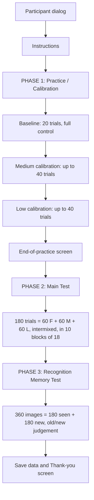

# Code Guide: `CARA_B_main_trialwise.py`

This guide walks you through the experiment script [`CARA_B_main_trialwise.py`](CARA_B_main_trialwise.py). You don't need to know the code or PsychoPy in advance. For each part of the experiment, it explains what happens and which part of the code does it.

> **Tip:** Line numbers refer to the current version of the script. If the code changes, the numbers may shift a little. The section headers in the code (`# ====...`) will still be there, so you can search for them instead.

---

## Table of Contents

1. [A Very Short PsychoPy Primer](#1-a-very-short-psychopy-primer)
2. [How to Run the Experiment](#2-how-to-run-the-experiment)
3. [The Experiment at a Glance](#3-the-experiment-at-a-glance)
4. [What Happens in a Single Trial](#4-what-happens-in-a-single-trial)
5. [Walking Through the Script, Section by Section](#5-walking-through-the-script-section-by-section)
6. [Output Files](#6-output-files)
7. [Quick Reference: Where Do I Change...?](#7-quick-reference-where-do-i-change)

---

## 1. A Very Short PsychoPy Primer

[PsychoPy](https://www.psychopy.org/) is a Python library for building experiments. This script uses only a few of its building blocks:

| PsychoPy piece | What it does | Example in this script |
|---|---|---|
| `visual.Window` | The (fullscreen) window that everything is drawn in. | `win = visual.Window(fullscr=True, units='pix', ...)` |
| `visual.Rect`, `visual.TextStim`, `visual.ImageStim`, `visual.Line` | **Stimulus objects**: rectangles, text, images, lines. You create them once and then draw them. | The black target square, the white frame, the instructions, the object images |
| `stim.draw()` + `win.flip()` | **How things get on screen.** `draw()` puts a stimulus on a hidden "back buffer". `win.flip()` swaps that buffer onto the screen. Nothing is visible until `flip()` is called. | Used everywhere |
| `event.waitKeys()` / `event.getKeys()` | Read the keyboard. `waitKeys` **pauses** until a key is pressed. `getKeys` **checks** for presses without pausing (used inside loops). | Waiting for SPACE on instruction screens; checking for SPACE/ESC while the frame moves |
| `event.Mouse` | Reads the mouse/touchpad position. | Moving the frame |
| `core.wait(s)` | Pause for `s` seconds. | Showing the image for 2 s |
| `core.Clock` | A stopwatch for timing. | Measuring trial duration |
| `gui.DlgFromDict` | A small pop-up form. | The participant info dialog at the start |
| `data.ExperimentHandler` | Collects data and writes it to a CSV file. `addData(name, value)` adds a column value. `nextEntry()` starts a new row. | Logging every trial |

**Units:** The window uses `units='pix'` (pixels), and the **centre of the screen is (0, 0)**. Positive `y` is up and negative `y` is down.

**Colours:** PsychoPy usually expresses colours on a **-1 to 1** scale instead of 0–255. For example, `[-1, -1, -1]` is black and `[1, 1, 1]` is white.

---

## 2. How to Run the Experiment

1. Install PsychoPy (the standalone PsychoPy app works, or `pip install psychopy`).
2. Keep the `chosen_stimuli_nolures/` folder **in the same folder** as the script. The script checks this at startup and stops with an error if the images are missing ([L484–495](CARA_B_main_trialwise.py#L484-L495)).
3. Run the script (e.g. open it in PsychoPy Coder and press *Run*, or `python CARA_B_main_trialwise.py`).
4. A dialog asks for **participant**, **age**, **gender**, **handedness**, and **check_mode**.
   - **`check_mode` ticked:** a very short version with only a few trials per phase. Use this to test that everything works.
   - **`check_mode` unticked:** the full experiment.
5. Press **ESC** at any time to abort. Data collected up to that point is saved automatically.

---

## 3. The Experiment at a Glance

Participants move a white frame (their "phone screen") with the touchpad onto a black square and press SPACE to "take a photo". The black square then turns into an object image from the THINGS database. The key manipulation is **how much control** participants have over the frame: random noise is mixed into their movements.

There are **three control conditions**:

| Key | Condition | Control level |
|---|---|---|
| `F` | Full control | 100% (no noise) |
| `M` | Medium control | Individually calibrated (see Phase 1) |
| `L` | Low control | Individually calibrated (see Phase 1) |

The experiment has **three phases**:



### Phase 1: Practice / Calibration
For participants, this is just "practice". **No images are shown** (only the black square) and there are no control ratings. In the background it does two things:

1. **Baseline** (20 trials at 100% control): measures how long the participant's movement path normally is when they have full control.
2. **Calibration** (two runs of up to 40 trials each, first medium and then low): an **adaptive algorithm** (adapted from Agarwal et al., 2022; see [Section 5.4](#54-adaptive-control-algorithm-l148331)) adjusts the noise level from trial to trial until the participant's movement path reaches the target difficulty ratio relative to their baseline (about 1.6× for medium, about 4.5× for low; determined from pilot data).
   - **What happens each trial:** The algorithm measures the frame's path length, calculates the recent moving average, and computes how far this is from the target baseline ratio. If the movement was too long (too difficult), it increases control (less noise) for the next trial; if too short (too easy), it decreases control (more noise).
   - **When it stops:** Each run stops as soon as the algorithm converges—specifically when the control level stabilizes (trial-to-trial changes < 0.03 over 5 trials) and the moving-average path length ratio is within ±0.5 of the target (or after a maximum of 40 trials). The average of the last 5 control levels is then saved as that participant's personal **Medium** or **Low** condition.

The aim is that "medium" and "low" control feel **more or less equally difficult for everyone**, even though participants differ in motor skill. If we do not calibrate, applying the same fixed proportion of perturbation produces very different levels of performance and sense of agency across individuals, introducing huge within-condition variability into the data that we would not want.

### Phase 2: Main Test
- 180 trials: 60 per condition, **intermixed** in a pseudo-random order.
- Split into **10 mini-blocks of 18 trials** (containing 6 Full, 6 Medium, and 6 Low control trials each). Participants can take a self-paced break between blocks.
- Never more than **3 trials of the same condition in a row**, including across block boundaries.
- Each trial reveals a **new object image** and ends with a **control (agency) rating** from 1 to 7.

### Phase 3: Recognition Memory Test
- Participants see the 180 images from the test phase mixed with 180 **new** images (foils), one at a time and in random order.
- For each image they press **A = "Old"** (seen before) or **S = "New"**.
- An optional 30-second break comes every 100 images.

### Randomization 

| Same for all participants | Different for each participant |
|---|---|
| The set of 180 test images and 180 new images (foils) | The order of the test images |
| The noise patterns used to disturb the frame | The order of F / M / L trials in the test phase |
| The number of trials, blocks, and the trial timeline | The order of images in the recognition test |
| The start and target positions on screen | The fixation durations (random between 0.5 and 0.8 s) |
| | The Medium and Low control levels (set by calibration) |

The random orders are generated from the **participant ID**. Running the script again with the same ID gives exactly the same orders, so a session can be reproduced.

---

## 4. What Happens in a Single Trial

All trials in Phases 1 and 2 are run by the same function, [`run_trial()`](CARA_B_main_trialwise.py#L750-L1073). Here is the sequence on screen:

| Step | What the participant sees | Duration | Code |
|---|---|---|---|
| 1. Fixation | Black fixation cross in the centre | 0.5–0.8 s (random) | [L774–786](CARA_B_main_trialwise.py#L774-L786) |
| 2. Movement | Black target square (top of screen) + white frame (bottom of screen). The participant moves the frame with the touchpad. | Until SPACE | [L825–1071](CARA_B_main_trialwise.py#L825-L1071) |
| 3. Shutter | SPACE is **only accepted if the frame fully encloses the square**. The frame briefly "flashes" larger. | 50 ms | [L832–864](CARA_B_main_trialwise.py#L832-L864) |
| 4. Delay | Black square only | 1 s | [L866–869](CARA_B_main_trialwise.py#L866-L869) |
| 5. Reveal *(test only)* | The object image replaces the black square | 2 s | [L871–894](CARA_B_main_trialwise.py#L871-L894) |
| 6. Agency rating *(test only)* | "How much control did you feel over the frame's movement?" A slider from 1 (no control) to 7 (full control), moved with LEFT/RIGHT and confirmed with SPACE. It starts at 4. | Until SPACE | [L897–1000](CARA_B_main_trialwise.py#L897-L1000) |
| 7. Compute and return | Path length and deviation are calculated. All trial info is packed into a dictionary and returned. | – | [L1002–1028](CARA_B_main_trialwise.py#L1002-L1028) |

### How the noise is added to the movement (Perlin noise)

This happens in the movement loop at [L1030–1056](CARA_B_main_trialwise.py#L1030-L1056). On every screen refresh:

1. The script checks how far the **real cursor** moved since the last refresh (`mouse_dx`, `mouse_dy`).
2. If the real cursor moved, a **noise value** is added to that movement for x and for y:
   ```python
   perturbed_dx = mouse_dx + (1 - control_level) * noise_val_x * NOISE_SCALE
   ```
   - With `control_level = 1.0` (full control), the noise term is zero, so the frame follows the finger exactly.
   - The lower the control level, the more noise is mixed in.
3. The frame moves by this "perturbed" amount and is kept inside the screen edges.
4. The frame position is saved with a timestamp in `trajectory`.

**What is Perlin noise?** It is a type of *smooth* random noise, often used in computer graphics for natural-looking textures. Unlike pure random numbers, which would make the frame jitter, Perlin noise changes gradually, so the frame **drifts** in smooth, unpredictable directions. You don't need to understand how it is calculated. The [`PerlinNoise`](CARA_B_main_trialwise.py#L73-L145) class at the top of the script produces these smooth values.

Note: noise is only added **while the participant is moving**. If they stop, the frame stops too.

---

## 5. Walking Through the Script, Section by Section

The script runs from top to bottom. Everything up to `main()` is **setup and function definitions**. The experiment itself starts when `main()` is called at the very end.

### 5.1 Imports ([L1–25](CARA_B_main_trialwise.py#L1-L25))
Loads PsychoPy (`visual`, `core`, `event`, `data`, `gui`) and standard Python helpers (`random`, `math`, `numpy`, etc.).

### 5.2 EEG Trigger Setup ([L27–67](CARA_B_main_trialwise.py#L27-L67)): *irrelevant for you*
This code sends event markers to an EEG system. It is switched off (`USE_TRIGGERS = False`). You will still see `send_trigger(...)` calls and `trigger_*` columns throughout the script. You can ignore them, because they do nothing when triggers are disabled.

### 5.3 Perlin Noise ([L69–145](CARA_B_main_trialwise.py#L69-L145))
The class that produces the smooth noise used to disturb the frame's movement (see [Section 4](#how-the-noise-is-added-to-the-movement-perlin-noise)). You don't need to read or change it.

### 5.4 Adaptive Control Algorithm ([L148–331](CARA_B_main_trialwise.py#L148-L331))
The calibration algorithm was adapted from Agarwal et al. (2022):

- Agarwal, R., Hussain, A., Skm, V., & Campolo, D. (2022). Let the force guide you: A performance-based adaptive algorithm for postural training using haptic feedback. *Frontiers in Human Neuroscience*, 16, 968669. [https://doi.org/10.3389/fnhum.2022.968669](https://doi.org/10.3389/fnhum.2022.968669)

You don't need to understand the underlying equations or how the algorithm works in detail. You just need to know that it **actively monitors performance on every trial and converges on an individualized noise level for each participant**.

In case you're interested, here's what the algorithm does on every trial (`process_trial()`):
1. **Measures the trial:** Records the path length travelled by the frame.
2. **Computes a running ratio:** Calculates the moving average path length over recent trials (window of 5) and divides it by the baseline path length (`current_ratio = avg_path_length / baseline_path_length`).
3. **Calculates the error:** Compares this ratio against the target ratio (1.62× for Medium, 4.46× for Low).
4. **Updates control for the next trial (`update_control()`):**
   - If the ratio is **above** the target (task was too hard / path was too long), it **increases** the control percentage (less noise) to make the next trial easier.
   - If the ratio is **below** the target (task was too easy / path was too short), it **decreases** the control percentage (more noise) to make the next trial harder.
   - Adjustments factor in both the current error and whether the error is growing or shrinking, bounded between 10% and 80% control.
5. **Checks for convergence (`has_converged()`):** It checks if two criteria are met simultaneously:
   - *Stability:* the proposed control values have stabilized (consecutive changes < 0.03 across 5 trials).
   - *Accuracy:* the recent moving average path-length ratio is within ±0.5 of the target ratio.
   If both conditions are met, calibration ends early without needing all 40 trials. Otherwise, it finishes after the 40th trial.
6. **Extracts the final level (`get_final_control()`):** The average of the last 5 control levels is stored and used as that participant's calibrated Medium or Low control level throughout the main test phase.


### 5.5 Module-Level Setup ([L334–408](CARA_B_main_trialwise.py#L334-L408))
Runs immediately when the script starts:
- Shows the **participant info dialog** ([L340–357](CARA_B_main_trialwise.py#L340-L357)).
- Creates the **output folders** `trialwise_data/` and `screenshots/` and builds the file names ([L359–371](CARA_B_main_trialwise.py#L359-L371)).
- Sets up the PsychoPy **`ExperimentHandler`**, which writes the CSV ([L373–379](CARA_B_main_trialwise.py#L373-L379)).
- Registers an **autosave** function, so data is saved even if the experiment crashes or is aborted with ESC ([L381–395](CARA_B_main_trialwise.py#L381-L395)).

### 5.6 Constants ([L411–495](CARA_B_main_trialwise.py#L411-L495))
**All main settings of the experiment live here.** The most important ones:

| Constant | Meaning |
|---|---|
| `BACKGROUND_COLOR` | Grey background |
| `DIST_CM`, `WIDTH_CM`, `STIM_SZ_DEG` | Viewing distance, monitor width, and desired stimulus size in degrees of visual angle. Together they determine the size of the square/image in pixels (`vis_ang_to_pix`). The viewing distance and monitor width are specific to the equipment used in the lab so if we were to run this experiment on a different monitor, we would need to update these values. This is why the stimuli might look different on your PCs if you run the experiment at home. |
| `NOISE_SCALE` | Overall strength of the Perlin noise |
| `TARGET_RATIO_MEDIUM` / `TARGET_RATIO_LOW` | Target path-length ratios for calibration (from pilot data) |
| `N_BASELINE_TRIALS` | Number of baseline trials (20) |
| `MAX_CALIBRATION_TRIALS` | Maximum calibration trials per difficulty (40) |
| `GAMMA`, `ALPHA`, `BETA`, `N_TRIALS_AVG` | Parameters of the adaptive algorithm. These were also decided based on pilot data. No need to know / include in your report. |
| `N_TEST_TRIALS_PER_CONDITION` | Test trials per condition (60) |
| `TRIALS_PER_MINIBLOCK` | Trials per block (18) |
| `MAX_SAME_CONDITION_RUN` | Maximum number of same-condition trials in a row (3) |
| `STIMULI_DIR`, `IMAGE_SEED` | Stimulus folder and the fixed seed for picking images |

Many constants have two values, e.g. `20 if CHECK_MODE else ...`. The first value is used in check mode.

[`sample_images()`](CARA_B_main_trialwise.py#L497-L530) picks the images. Because it uses a **fixed seed**, all participants see the **same set** of test images and foils, but in a different order.

### 5.7 Global Data Storage ([L533–577](CARA_B_main_trialwise.py#L533-L577))
`experiment_data` is a large nested dictionary that collects **everything**, including full movement trajectories. It is saved as a JSON file at the end. `image_condition_map` records which condition (F/M/L) each image was shown under.

### 5.8 Helper Functions ([L580–649](CARA_B_main_trialwise.py#L580-L649))
- `apply_boundary_constraints`: keeps the frame on screen, so it cannot go out of bounds and disappear.
- `calculate_deviation`: average distance of the movement from an ideal straight line.
- `calculate_path_length`: total distance the frame travelled. **This is the main measure used by the calibration.**
- `save_experiment_data`: writes the JSON file.

### 5.9 Instruction Screens ([L656–747](CARA_B_main_trialwise.py#L656-L747))
- `show_instructions`: the welcome and task instructions shown at the start.
- `show_calibration_results`: the "practice complete" screen before the main test.

To change instruction text, edit the `lines = [...]` lists in these functions.

### 5.10 Single Trial: `run_trial()` ([L750–1073](CARA_B_main_trialwise.py#L750-L1073))
The core of the experiment. See [Section 4](#4-what-happens-in-a-single-trial).

### 5.11 Phase 1: Calibration ([L1076–1275](CARA_B_main_trialwise.py#L1076-L1275))
- [`run_baseline_trials()`](CARA_B_main_trialwise.py#L1076-L1124): runs the baseline trials at 100% control and returns the participant's average path length.
- [`run_calibration_phase()`](CARA_B_main_trialwise.py#L1127-L1236): runs the baseline, then creates two adaptive algorithms (medium and low), then runs the medium calibration loop followed by the low calibration loop. After each trial, the algorithm proposes the next control level.
- [`extract_calibration_results()`](CARA_B_main_trialwise.py#L1239-L1275): reads the final medium and low control levels and stores them for the test phase.

### 5.12 Phase 2: Test ([L1278–1443](CARA_B_main_trialwise.py#L1278-L1443))
- [`make_trialwise_sequence()`](CARA_B_main_trialwise.py#L1289-L1337): builds the trial order (10 blocks, each with 6 F, 6 M, and 6 L, shuffled). It reshuffles a block until there are no more than 3 same-condition trials in a row. The order differs per participant but is reproducible from the participant ID.
- [`run_test_phase()`](CARA_B_main_trialwise.py#L1340-L1443): loops over the blocks and trials, calls `run_trial()` with the right control level and image, logs each trial to the CSV, and shows the break screen between blocks.

### 5.13 Phase 3: Recognition ([L1446–1622](CARA_B_main_trialwise.py#L1446-L1622))
[`run_recognition_phase()`](CARA_B_main_trialwise.py#L1449-L1622):
- Shows the instructions.
- Mixes seen and new images and shuffles them.
- For each image: fixation cross (0.5–0.8 s), then the image with the question "Have you seen this image...?", then a wait for **A** (old) or **S** (new).
- Records the response, accuracy, and reaction time, plus which condition the image was originally seen in (`encoding_condition`).
- Offers a 30-second break every 100 images.

### 5.14 `main()`: Putting It All Together ([L1629–1724](CARA_B_main_trialwise.py#L1629-L1724))
This is where the experiment actually runs, in order:
1. Stores participant info and creates the participant-specific random number generators ([L1631–1646](CARA_B_main_trialwise.py#L1631-L1646)).
2. Opens the fullscreen window, hides the cursor, and computes stimulus sizes ([L1648–1664](CARA_B_main_trialwise.py#L1648-L1664)).
3. Sets the **target position** (top third of the screen) and the **start position** of the frame (bottom third) ([L1666–1667](CARA_B_main_trialwise.py#L1666-L1667)).
4. Phase 1: instructions, calibration, and the end-of-practice screen ([L1669–1679](CARA_B_main_trialwise.py#L1669-L1679)).
5. Picks the images and shuffles their order for this participant ([L1681–1689](CARA_B_main_trialwise.py#L1681-L1689)).
6. Phase 2: test ([L1691–1692](CARA_B_main_trialwise.py#L1691-L1692)).
7. Phase 3: recognition ([L1694–1696](CARA_B_main_trialwise.py#L1694-L1696)).
8. Saves data and shows the thank-you screen ([L1698–1720](CARA_B_main_trialwise.py#L1698-L1720)).

The pattern `if not ...: _save(); win.close(); core.quit(); return` after each phase means: **if the participant pressed ESC, save and quit.**

---

## 6. Output Files

The script creates these files and folders next to itself:

| Location | Content |
|---|---|
| `trialwise_data/<participant>_<date>.csv` | **One row per trial** across all phases. The `phase` column tells you which phase a row belongs to (`baseline`, `calibration_medium`, `calibration_low`, `test`, `recognition`). This is the file you will mainly analyse. |
| `trialwise_data/<participant>_<date>.json` | **Everything**, including full movement trajectories and the calibration algorithm's history. |
| `screenshots/` | One example screenshot per phase, useful for figures. |

Important CSV columns:

| Column | Meaning |
|---|---|
| `phase`, `block_num`, `trial_within_block`, `condition` | Where the trial belongs (condition = F/M/L) |
| `control_level` | Control level used (1.0 = full control) |
| `duration` | Time from trial start to SPACE press (s) |
| `first_move_time`, `movement_duration` | When the participant started moving, and how long they moved |
| `path_length`, `mean_deviation` | Movement measures (pixels) |
| `control_rating` | Agency rating (1–7, test phase only) |
| `image_id` | Name of the image shown |
| `ground_truth`, `response`, `accuracy`, `rt` | Recognition phase: was the image seen, what the participant answered, whether they were correct, and their reaction time |
| `encoding_condition` | Recognition phase: the condition a seen image was shown under during the test |
| `algo_*` | Calibration phase: internal values of the adaptive algorithm |
| `trigger_*`, `mem_trigger_*` | EEG trigger codes; you can ignore these |

---

## 7. Quick Reference: Where Do I Change...?

| I want to change... | Go to |
|---|---|
| Number of trials / blocks | Constants: `N_BASELINE_TRIALS`, `MAX_CALIBRATION_TRIALS`, `N_TEST_TRIALS_PER_CONDITION`, `TRIALS_PER_MINIBLOCK` ([L458–482](CARA_B_main_trialwise.py#L458-L482)) |
| Strength of the noise | `NOISE_SCALE` ([L439](CARA_B_main_trialwise.py#L439)) |
| Stimulus size | `STIM_SZ_DEG`, `DIST_CM`, `WIDTH_CM` ([L419–421](CARA_B_main_trialwise.py#L419-L421)) |
| Colours | [L416](CARA_B_main_trialwise.py#L416) and [L443–446](CARA_B_main_trialwise.py#L443-L446) |
| Instruction texts | `show_instructions()` / `show_calibration_results()` ([L656–747](CARA_B_main_trialwise.py#L656-L747)), break text in `run_test_phase()`, recognition instructions in `run_recognition_phase()` |
| Timing (fixation, reveal duration) | Inside `run_trial()`: `rng.uniform(0.5, 0.8)`, `core.wait(1.0)`, `core.wait(2.0)` |
| Rating question / scale labels | Inside `run_trial()` ([L906–927](CARA_B_main_trialwise.py#L906-L927)) |
| Recognition response keys | `run_recognition_phase()` ([L1483–1486](CARA_B_main_trialwise.py#L1483-L1486) and [L1536–1554](CARA_B_main_trialwise.py#L1536-L1554)) |

> **Before changing anything**, run the experiment once in **check mode** to see how it works. After any change, test it again in check mode.
